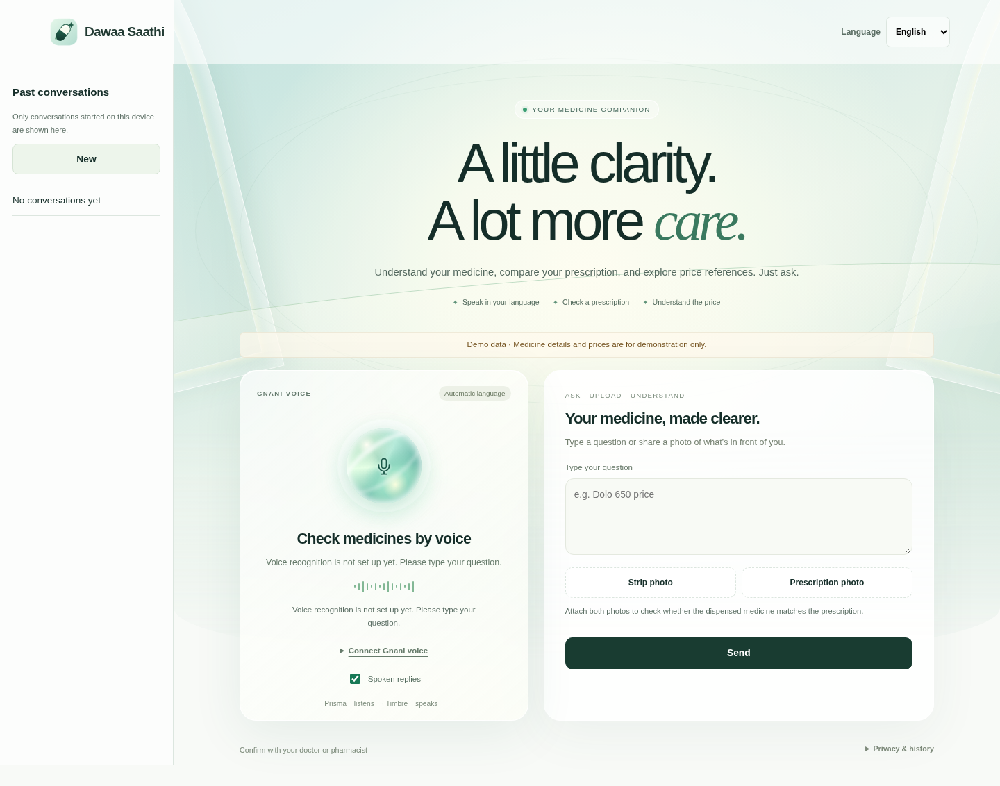
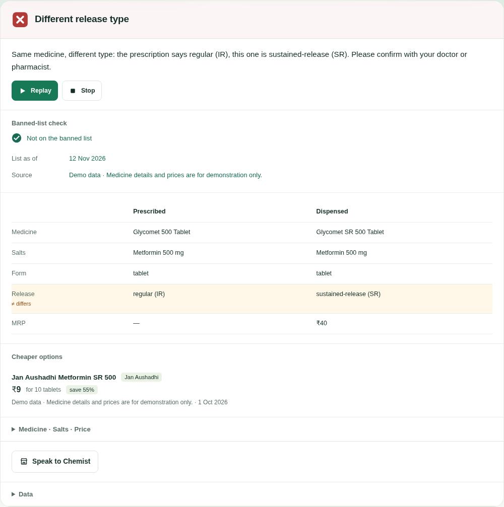
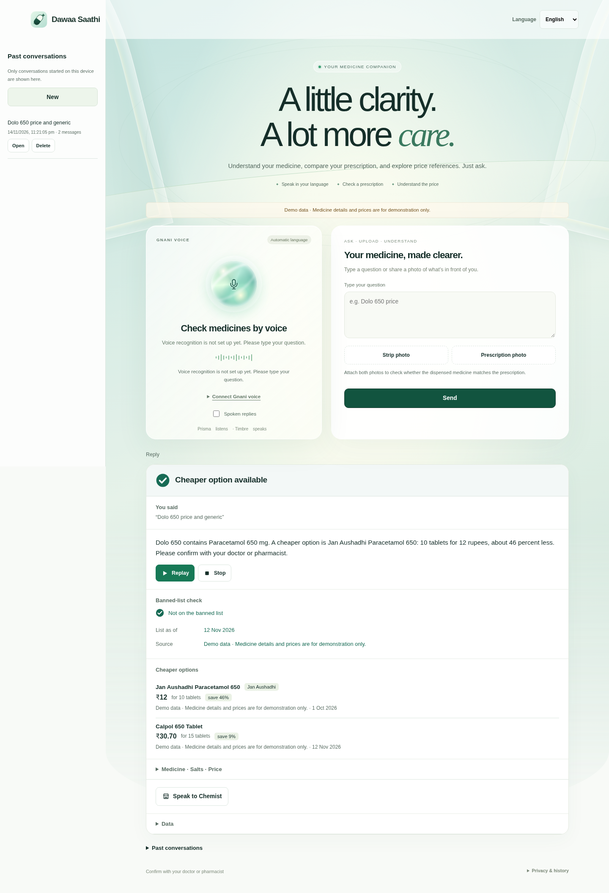
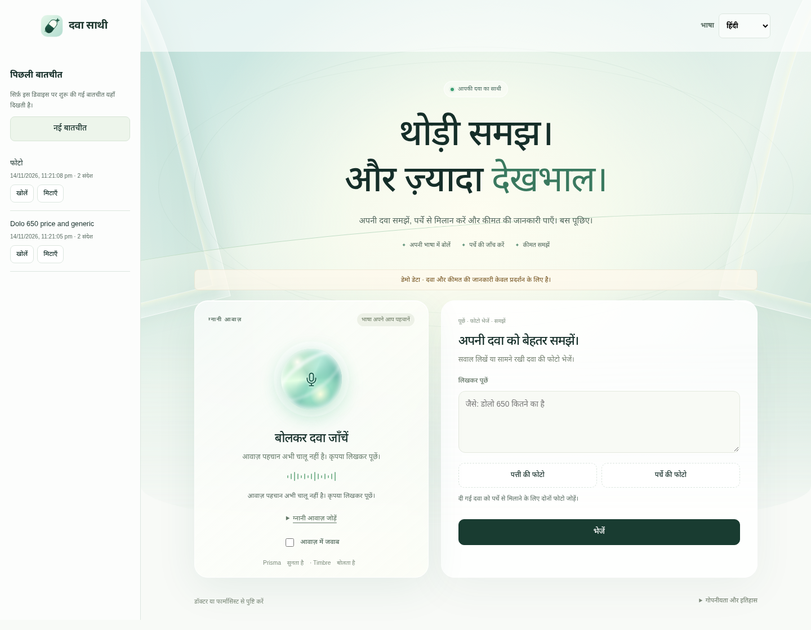
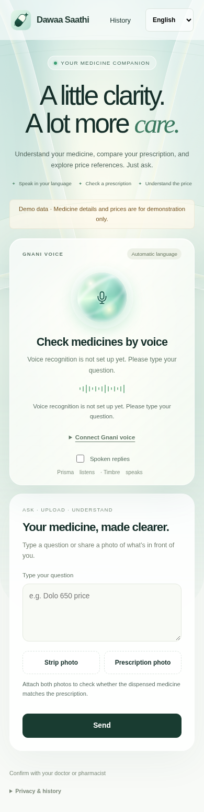

<p align="center">
  
</p>
<h1 align="center">Dawaa Saathi</h1>
<p align="center"><strong>A multilingual medicine companion powered by Gnani voice.</strong></p>
<p align="center">Speak naturally. Understand a medicine. Compare a prescription. Explore price references.</p>



> **Data status:** the bundled starter dataset is a development fixture. Its medicine prices,
> price ceilings, banned-combination example and batch alert are demonstration material.
> Replace it with sourced, reviewed data before using the results for real decisions.

## Contents

- [What it does](#what-it-does)
- [Screenshots](#screenshots)
- [Quick start](#quick-start)
- [Gnani voice and languages](#gnani-voice-and-languages)
- [How answers are produced](#how-answers-are-produced)
- [Local data and optional web fallback](#local-data-and-optional-web-fallback)
- [Configuration](#configuration)
- [API](#api)
- [Project structure](#project-structure)
- [Validation](#validation)
- [Docker](#docker)
- [Troubleshooting](#troubleshooting)

## What it does

| Feature | Behavior |
| --- | --- |
| Voice questions | Gnani Prisma transcribes a recorded question and detects its language. |
| Spoken answers | Gnani Timbre speaks the answer in the detected language. Automatic playback has a sound toggle, replay and stop controls. |
| Typed questions | Look up medicine composition, available price references and matching alternatives. |
| Photo comparison | Upload a prescription, a medicine strip, or both. Compare ingredients, strength, form, release type and liquid concentration. |
| Confirmation | Ambiguous medicine names produce candidate choices instead of a guessed match. |
| Source-aware results | Display dataset dates, provenance, banned-list status and batch warnings when information is available. |
| Chat history | A desktop sidebar supports new, open and delete actions; mobile opens the same panel from History. |
| Multilingual UI | The language selector updates interface text, accessibility labels and saved assistant answers. Original user messages and medicine names remain as supplied. |
| Responsive interface | Mint gradients, translucent panels and a voice orb, with layouts for desktop and mobile. |

The app does not schedule appointments, update clinic records, prescribe treatment, or establish
that a medicine is safe for a particular person. A missing banned-list entry is not a safety approval.

## Screenshots

These are **real Chromium captures** of the local application, using synthetic sample images and
an isolated history database. The screenshot instance has no speech credentials, so its voice
panel honestly displays the setup state. The capture did not simulate a connected provider.

### Prescription comparison

An actual upload of the bundled prescription and strip samples produces an IR/SR release mismatch:



<details>
<summary><strong>Medicine result and conversation history</strong></summary>



All prices and alerts visible here belong to the demonstration dataset.

</details>

<details>
<summary><strong>Hindi interface</strong></summary>



</details>

<details>
<summary><strong>Mobile layout</strong></summary>



</details>

Capture details and reproduction: [screenshots](docs/screenshots/README.md).

## Quick start

### Requirements

- Python **3.14+** and [uv](https://docs.astral.sh/uv/).
- A modern browser. Microphone capture requires **localhost or HTTPS** and microphone permission.
- `ffmpeg` for audio conversion and compressed audio downloads.
- Optional: `tesseract` as an additional local OCR fallback. RapidOCR is included in Python dependencies;
  its first use may download its OCR models.

The frontend is plain HTML, CSS and JavaScript, served by FastAPI. **One process starts both
frontend and backend. No frontend build or Node.js installation is required to run the app.**

### Install

From the project directory:

```bash
uv sync --frozen
```

For a **new checkout**, copy the configuration template and edit `.env`:

```bash
cp .env.example .env
```

Keep an existing `.env`; do not overwrite configured credentials. For Gnani speech, set:

```dotenv
GNANI_API_KEY=your_actual_gnani_key
TIMBRE_MODEL=timbre-v3.0
TIMBRE_VOICE=Shivani
```

Keys stay on the server. Never add them to frontend files or commit `.env`.
Without speech credentials, typed queries and local OCR can still work; Gnani voice stays unavailable.

### Prepare a starter database

Only create the demo database if one does not already exist:

```bash
test -f var/dawasaathi.db || uv run python -m scripts.load_data --src data/seed_dev
```

The importer **rebuilds its destination database** by default. See [data loading](data/README.md)
before replacing an existing database.

### Start frontend and backend

```bash
.venv/bin/python -m uvicorn app.main:app --host 127.0.0.1 --port 8001 --reload
```

Open **http://127.0.0.1:8001**. API documentation: **http://127.0.0.1:8001/docs**.
Stop the server with **Ctrl+C**. Restart after changing environment variables or reloading data.

## Gnani voice and languages

The speech path is:

```text
Microphone → 16 kHz WAV → Gnani Prisma v3 → local matching and rules
           → localized answer template → Gnani Timbre v3 → audio playback
```

1. Tap the voice orb and allow microphone access.
2. Ask a medicine question in a supported language.
3. Pause or tap again to send the recording.
4. Review the recognized words, read the answer and listen to playback.
5. Use stop/replay or turn off **Spoken replies** when you prefer text.

Speech uses `prisma-v3.0` with automatic language detection. **The spoken language determines the
answer language**, independently of the selected interface language. Typed questions follow the
interface language.

| Language | Code | Language | Code |
| --- | --- | --- | --- |
| Hindi | `hi` | English | `en` |
| Marathi | `mr` | Bengali | `bn` |
| Gujarati | `gu` | Punjabi | `pa` |
| Tamil | `ta` | Telugu | `te` |
| Kannada | `kn` | Malayalam | `ml` |

Only these ten languages are selectable, matching the configured Gnani speech models.
[Gnani model documentation](https://github.com/Gnani-AI-Mintlify/Gnani-Vachana#prisma-v30-multilingual-model).

Voice requests bypass optional text-model understanding, reply rewriting and web-extraction helpers.
They use the recognized transcript, local medicine records, deterministic checks and localized
templates. This boundary also applies to confirmations and stream/phone turns. An explicitly
attached photo can still use the configured image-reading provider; that is separate from speech.

More details: [voice configuration and verification](docs/voice-setup.md).

## How answers are produced

```text
Typed question / recognized speech / prescription and strip photos
                             │
                     Extract medicine details
                             │
                  Match against the loaded database
                             │
              Ambiguous? Ask the user to confirm a candidate
                             │
       Compare ingredients · strength · form · release · concentration
       Check loaded banned/batch lists · calculate price references
                             │
                  Render a guarded, localized result
                             │
                  Save history · generate reply audio
```

The verdict engine uses structured data and code rules. Optional helpers can assist typed queries
or image reading, but their output must pass the corresponding parsing and validation checks.
If details are incomplete, the app asks for confirmation or another photo, or reports an
unverified result.

## Local data and optional web fallback

### What the data folder means

The app does **not** read every file under `data/` on each question. The importer builds
`var/dawasaathi.db`; the server then loads that database into memory at startup.

| Location | Purpose |
| --- | --- |
| `data/seed_dev/` | Synthetic starter brands, aliases, reference prices, example alerts and metadata. |
| `data/gov/` | Imported reference files. Presence here alone does not activate them. |
| `var/dawasaathi.db` | Active imported medicine database. |
| `var/local.db` | Persistent conversations and web-learned brand records, kept apart from the imported database. |
| `var/web_uses.json` | Cache of source-backed usual-use lookups and misses. |
| `var/tts_cache/` | Generated clause-level speech cache. |

A reviewed dataset can be loaded with:

```bash
uv run python -m scripts.load_data --src data/real
```

`data/real` is an example destination you must supply; it is not bundled. To explicitly import
a government price-reference file alongside a chosen source directory:

```bash
uv run python -m scripts.load_data --src data/real --price-ref data/gov/price_ref.csv
```

Both commands rebuild the target database. Restart the server afterwards and check the sources
and dates in the results. File formats, provenance and importer options: [data/README.md](data/README.md).

### When web fallback runs

Optional **typed-query** fallback searches approved pharmacy/medical domains when a brand is
missing or when local usual-use information is unavailable. It requires `TAVILY_API_KEY`, the
relevant `WEB_BRANDS` / `WEB_LOOKUP` flag, and a configured extraction helper. Flags alone do not
enable searches. Advanced non-voice settings are documented in [.env.example](.env.example).

Accepted brand results retain their source URL and date, are saved to `var/local.db`, and are
added to the matcher for reuse, including after a restart. Usual-use results are cached separately.
Searches that fail or do not pass validation do not become medicine records.

This expands a **local knowledge store**; it does not train the speech model or rewrite the
original CSV files. Passing extraction checks is not equivalent to clinical review. Successful
cached entries currently have no automatic refresh policy; misses are cached for seven days.
Banned-combination lists, official reference prices and batch alerts are not automatically replaced
by web-search results.

## Configuration

| Setting | Purpose |
| --- | --- |
| `GNANI_API_KEY` | Enables Gnani Prisma recognition and Timbre speech. |
| `TIMBRE_MODEL`, `TIMBRE_VOICE` | Speech model and voice selection. |
| `TIMBRE_SAMPLE_RATE`, `TIMBRE_SPEED` | Output audio rate and speech speed. |
| `OCR_PROVIDERS` | Photo-reading provider order; use `rapidocr,tesseract` for local-only OCR. |
| `DAWA_DB_PATH` | Imported medicine database path. |
| `LOCAL_DB_PATH` | Conversation and learned-brand database path. |
| `DAWA_CACHE_DIR` | Speech-cache directory. |
| `TAVILY_API_KEY`, `WEB_BRANDS`, `WEB_LOOKUP` | Optional typed-query web fallback. |
| `DATA_STALE_DAYS` | Age threshold used by relevant safety and reference-price checks. |
| `SESSION_TTL_S` | Short-term session context lifetime; default 900 seconds. |
| `RATE_LIMIT_PER_MIN` | Per-client request limit. |
| `EXPOSE_DEBUG` | Internal diagnostics; keep disabled for shared deployments. |

See [.env.example](.env.example) for the complete configuration. Generated audio jobs expire
separately from persistent history. The application currently has **no user accounts**: conversation
IDs act as access keys. Do not treat it as an authenticated multi-user patient-record system.

## API

| Method | Endpoint | Purpose |
| --- | --- | --- |
| `GET` | `/healthz` | Service state, provider modes and loaded record counts. |
| `GET` | `/v1/config` | Supported languages, upload limits and dataset metadata. |
| `POST` | `/v1/query` | Multipart text/audio/photo medicine query. |
| `POST` | `/v1/confirm` | Confirm or reject an ambiguous candidate. |
| `POST` | `/v1/speak` | Generate audio for the chemist script. |
| `POST` | `/v1/interrupt` | Cancel current session audio generation. |
| `GET` | `/v1/audio/{id}.pcm` | Stream reply audio. |
| `GET` | `/v1/drugs/search` | Search loaded medicine names. |
| `GET` | `/v1/alternatives` | Look up matching alternatives. |
| `GET` | `/v1/threads?ids=...` | Summaries for conversation IDs held by the client. |
| `GET` | `/v1/threads/{id}` | Read saved conversation messages. |
| `GET` | `/v1/threads/{id}/localized?lang=hi` | Re-render stored assistant answers in another supported language. |
| `DELETE` | `/v1/threads/{id}` | Delete a conversation. |
| `WS` | `/v1/stream` | Additional streaming speech interface. |

Example typed query:

```bash
curl http://127.0.0.1:8001/v1/query \
  -F 'lang=en' \
  -F 'text=Dolo 650 price and generic'
```

Recorded speech uses an audio file plus `detect_language=true`. Do not send a `text` field when
testing recognition: text takes precedence over audio transcription. The website uses recorded
WAV uploads; the WebSocket endpoint is a separate interface, not the voice orb's transport.

## Project structure

```text
app/
  adapters/          Speech, OCR and optional external-service clients
  api/               REST, WebSocket and session handling
  dialogue/          Localized templates, spoken formatting and output checks
  engine/            Comparison, pricing, safety and web-result validation
  match/             Medicine matching and transliteration
  nlu/               Rule-based intent, entities and number parsing
  pipeline.py        Request orchestration
  localization.py    Re-render stored facts in another language
  localdb.py         Persistent history and learned brands
web/                 Browser UI, microphone capture, playback and translations
data/                Import sources and metadata
samples/             Synthetic medicine and prescription images
tests/               Python regressions and fixtures
scripts/             Import, evaluation and integration-check utilities
artifacts/           Recorded verification reports
docs/                Setup notes, screenshots and validation details
```

## Validation

Run the Python tests:

```bash
uv run pytest -q
```

Exercise a running **isolated demo instance** with actual image uploads and HTTP/WebSocket calls:

```bash
.venv/bin/python scripts/check_user_flows.py \
  --base-url http://127.0.0.1:8002 \
  --output artifacts/user-flow-checks.json
```

The checker expects demo brands and removes only the synthetic conversations it creates.
See [verification instructions](docs/verification.md) for isolated database/cache setup and
frontend checks. Test counts can change with the supported-language set; use the latest run's
output instead of treating an older report as current.

Evidence is separated by what was actually exercised:

- [Live spoken-language checks](artifacts/live-spoken-language-checks.json): synthesized Hindi
  and English recordings passed through live Gnani STT, then produced matching-language text
  and nonempty Timbre audio. This does not establish microphone capture or accent accuracy.
- [Voice-control checks](artifacts/voice-language-checks.json): simulated capture, language routing,
  automatic playback control, quiet submission, cancellation and sidebar presence.
- [UI-language checks](artifacts/ui-language-checks.json): interface language switching and saved-answer rendering.
- [UI action checks](artifacts/web-action-checks.json): local-backend interactions, photo uploads and error recovery.
- [README screenshots](docs/screenshots/README.md): actual desktop/mobile Chromium rendering and real sample-photo comparison.

Physical microphone capture, audible playback, field accuracy and public deployment require
separate validation. Demo data and passing tests do not establish clinical correctness.

## Docker

```bash
docker build -t dawasaathi .
docker run --rm --env-file .env -p 8000:8000 dawasaathi
```

Open **http://localhost:8000**. The default image imports the demo dataset. For a reviewed dataset
inside the build context, pass `--build-arg DATA_DIR=data/real` when building. Persist `/app/var`
if you need history and caches to survive container replacement; retain the initialized medicine
database when mounting that directory. Run one application worker because sessions and audio jobs
are held in process memory.

## Troubleshooting

| Symptom | Check |
| --- | --- |
| Voice orb shows setup required | Set the server-side `GNANI_API_KEY`, restart, then refresh. |
| Microphone does not start | Use localhost/HTTPS; allow microphone access and check the OS input device. |
| Recording has no words | Confirm the input device works, speak clearly and tap again to submit. An empty transcript returns a recoverable speech error. |
| Answer text appears without sound | Enable Spoken replies, check browser/site sound settings, and try Replay. A failed or empty provider audio stream falls back to browser speech when available. |
| Wrong or missing medicine match | Include the printed strength and release suffix, or attach a clear photo of the back of the strip. |
| Added files have no effect | Import them into the active database and restart; the server does not automatically ingest the data folder. |
| Web search does not run | Check search credentials, extraction-helper configuration and feature flags. Voice requests intentionally do not use these optional helpers. |
| Old-looking UI | Refresh with Ctrl+Shift+R. API responses are never cached by the service worker. |
| Port 8001 is busy | Stop the existing instance or choose another port. |

---

For medicine decisions, confirm the original label and prescription with a doctor or pharmacist.
